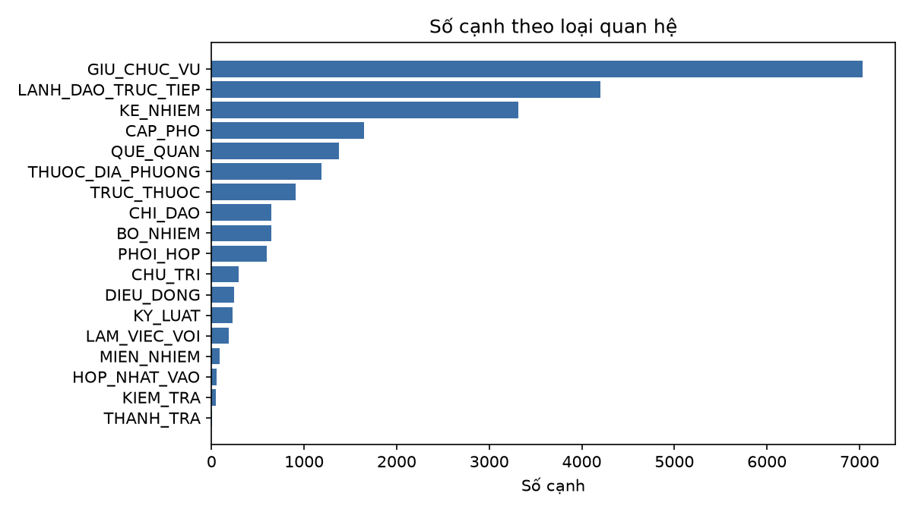
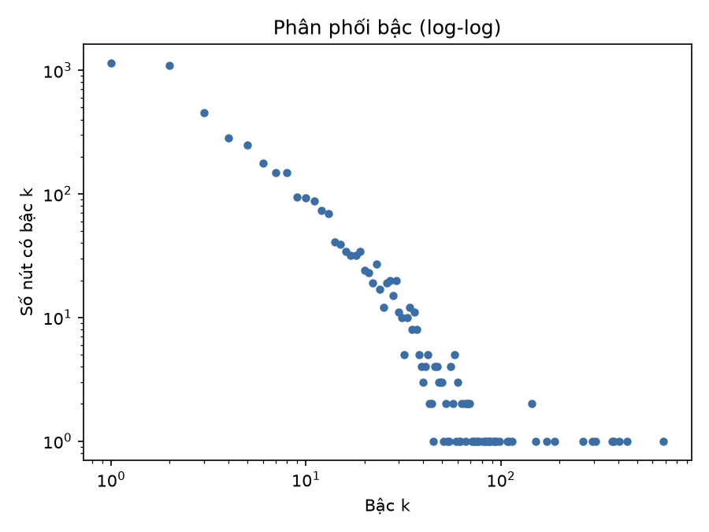

# BÁO CÁO BÀI TẬP LỚN – PHÂN TÍCH MẠNG XÃ HỘI

## Xây dựng mạng lưới Chính trị gia và Cơ quan Quản lý Nhà nước Việt Nam từ Wikipedia và tin tức

| | |
|---|---|
| Học phần | Phân tích mạng xã hội **[CẦN ĐIỀN mã lớp]** |
| Giảng viên | **[CẦN ĐIỀN]** |
| Nhóm thực hiện | **[CẦN ĐIỀN họ tên – MSSV thành viên 1]**, **[CẦN ĐIỀN họ tên – MSSV thành viên 2]** |
| Mã nguồn | **[CẦN ĐIỀN link GitHub]** |
| Ngày nộp | 11/11/2026 |

---

## Tóm tắt

Nhóm xây dựng một đồ thị tri thức về các chính trị gia và cơ quan nhà nước Việt Nam. Đồ thị gồm **4.719 nút** (2.745 người, 1.910 cơ quan, 64 tỉnh/thành) và **22.706 cạnh**, thuộc **18 loại quan hệ**, lưu trong cơ sở dữ liệu đồ thị Neo4j.

Đồ thị được dựng từ hai lớp dữ liệu:

1. **Lớp khung có cấu trúc**, bóc tách từ hộp thông tin (infobox) của khoảng 3.100 trang Wikipedia tiếng Việt. Lớp này gồm 8 loại cạnh: giữ chức vụ, kế nhiệm, cấp trên trực tiếp, cấp phó, trực thuộc, thuộc địa phương, hợp nhất (theo đợt sắp xếp bộ máy năm 2025) và quê quán.
2. **Lớp sự kiện**, trích xuất từ **20.599 bài báo** Thời sự – Chính trị (Báo Mới, Báo Chính phủ, VnExpress, Thanh Niên…). Lớp này gồm 10 loại quan hệ: chủ trì, chỉ đạo, bổ nhiệm, điều động, miễn nhiệm, thanh tra, kiểm tra, kỷ luật, làm việc với và phối hợp.

Phần trích xuất từ tin tức không dùng mô hình ngôn ngữ lớn hay API trả phí. Toàn bộ dựa trên chuẩn hoá văn bản, nhận diện thực thể bằng từ điển (gazetteer) cộng mẫu chức danh, đồng tham chiếu trong phạm vi bài báo, và tập luật trích quan hệ có ràng buộc kiểu thực thể. Cả pipeline xử lý 550 nghìn câu trong khoảng 2,5 phút trên máy cá nhân.

Trên mẫu ngẫu nhiên 104 cạnh do nhóm kiểm tra sơ bộ, độ chính xác ước tính đạt **95,2%** (khoảng tin cậy 95%: 89,2%–97,9%). Kết quả gán nhãn thủ công đầy đủ trên 200 cạnh được trình bày ở Mục 7.

---

## 1. Giới thiệu

### 1.1. Bối cảnh và mục tiêu

Hệ thống chính trị Việt Nam có cấu trúc nhiều tầng: Đảng, Nhà nước, Quốc hội, Mặt trận, cùng các cấp trung ương và địa phương. Một người thường đồng thời giữ nhiều chức vụ, ví dụ "Ủy viên Bộ Chính trị, Bí thư Trung ương Đảng, Trưởng Ban Tổ chức Trung ương". Quá trình công tác của mỗi người cũng thay đổi liên tục qua điều động, luân chuyển, bổ nhiệm và miễn nhiệm.

Biểu diễn những thông tin này dưới dạng **mạng** cho phép trả lời các câu hỏi khó trả lời bằng bảng:

- Ai là các nhân vật trung tâm?
- Cơ quan nào kết nối nhiều đơn vị nhất?
- Đường đi ngắn nhất giữa hai lãnh đạo đi qua những vị trí nào?
- Ai từng công tác ở đâu, và ai đã được điều động từ địa phương lên trung ương?

Năm 2025 có đợt sắp xếp bộ máy lớn. Bộ ngành được hợp nhất, và số tỉnh giảm từ 63 xuống 34 theo Nghị quyết 202/2025/QH15. Vì vậy mạng cần biểu diễn được cả quan hệ **lịch sử** của đơn vị cũ lẫn đơn vị mới.

**Mục tiêu của bài tập** (theo yêu cầu học phần):

| Yêu cầu | Kết quả đạt được |
|---|---|
| ≥ 2.000 nút | 4.719 nút |
| ≥ 5.000 cạnh | 22.706 cạnh |
| ≥ 10 loại quan hệ | 18 loại (10 loại trích xuất từ tin tức bằng NLP) |
| Độ chính xác ≥ 90% (đánh giá cuối kỳ) | Ước tính 95,2% trên mẫu sơ bộ; xem Mục 7 |
| Lưu trữ, truy vấn, trực quan | Neo4j 5.26 + APOC + GDS, Neo4j Browser |

### 1.2. Phạm vi

- **Thời gian:** chức vụ còn hiệu lực từ năm 2006 trở đi. Tin tức chủ yếu từ năm 2024 đến tháng 11/2026.
- **Thực thể:**
  - Người: lãnh đạo Đảng, Nhà nước, bộ ngành, địa phương cấp tỉnh, lực lượng vũ trang.
  - Cơ quan: cơ quan Đảng, Quốc hội, Chính phủ, bộ, sở, Ủy ban nhân dân (UBND), Hội đồng nhân dân (HĐND), cơ quan tư pháp, doanh nghiệp nhà nước trọng điểm.
  - Đơn vị hành chính cấp tỉnh.
- **Ràng buộc kỹ thuật:** không dùng API mô hình ngôn ngữ lớn trả phí. Phần NLP dùng luật và gazetteer. Mô hình nhỏ (PhoBERT) dành cho giai đoạn cuối kỳ.

### 1.3. Đóng góp chính

1. Một pipeline mở, chạy lại được, từ thu thập đến đồ thị Neo4j, với mã nguồn cho từng bước.
2. Bộ gazetteer khoảng 1.700 người và 1.200 cơ quan, có alias viết tắt và bảng sáp nhập bộ ngành, tỉnh năm 2025.
3. Bộ luật trích 10 loại quan hệ sự kiện từ tin tức tiếng Việt. Bộ luật xử lý câu bị động, danh sách nhiều người, chuỗi chức danh ghép và đồng tham chiếu chức danh.
4. Phân tích mạng: phân bố bậc, thành phần liên thông, hệ số phân cụm, PageRank, top nhân vật và cơ quan trung tâm.

---

## 2. Dữ liệu

### 2.1. Nguồn dữ liệu

| Nguồn | Cách thu thập | Số lượng | Vai trò |
|---|---|---|---|
| Wikipedia tiếng Việt | MediaWiki API: duyệt cây thể loại, tải wikitext, có cache | 3.134 trang (2.297 người có infobox) | Lớp khung: người, cơ quan, chức vụ, nhiệm kỳ |
| Wikidata | QID kèm trang Wikipedia | – | Định danh duy nhất cho người |
| Báo Mới (corpus của nhóm) | Crawl theo chủ đề chính trị | 5.259 bài | Tin tức sự kiện |
| Báo Chính phủ (baochinhphu.vn) | API timeline chuyên mục "Chính trị", "Chỉ đạo – quyết định" | 12.072 bài | Tin hoạt động lãnh đạo, quyết định nhân sự |
| Báo Chính phủ, tìm kiếm theo từ khoá | 19 từ khoá: "kết luận thanh tra", "thi hành kỷ luật", "miễn nhiệm"… | 1.270 bài | Bổ sung các quan hệ hiếm |
| VnExpress (Thời sự > Chính trị, Nhân sự) | Crawl chuyên mục | 878 bài | Tin nhân sự |
| Corpus 5.000 bài đa chuyên mục (Thanh Niên, VnExpress, Tuổi Trẻ…) | Lọc bài có ≥ 3 từ khoá chính trị | 1.120 bài | Bổ sung |
| Cấu hình thủ công | `config/provinces_2025.json`, `config/org_mergers_2025.json` | 63 → 34 tỉnh; khoảng 20 cơ quan sáp nhập | Sắp xếp bộ máy 2025, alias viết tắt |

Sau khi bỏ trùng theo URL và tiêu đề, corpus tin tức còn **20.599 bài** với **550.296 câu**. Crawler tuân thủ `robots.txt`, giới hạn 4 luồng và nghỉ giữa các trang danh sách. Crawler cũng ghi tiếp được: khi chạy lại, các URL đã có hoặc đã lỗi được bỏ qua.

### 2.2. Tiền xử lý văn bản

Script `preprocess/build_corpus.py` và module `extraction/textnorm.py` thực hiện bốn việc:

- **Chuẩn hoá Unicode NFC**, bỏ ký tự khoảng trắng đặc biệt (NBSP, zero-width).
- **Chuẩn hoá kiểu bỏ dấu** từ kiểu cũ sang kiểu mới (`oà→òa`, `uỷ→ủy`, `Khánh Hoà→Khánh Hòa`), có ngoại lệ cho "qu" (`quý` giữ nguyên). Bước này quan trọng vì gazetteer và tin tức dùng lẫn hai kiểu.
- **Tách câu** bằng regex. Các chữ viết tắt (`TP.`, `TS.`, `PGS.`…) được bảo vệ, và dấu ngoặc kép đóng câu được giữ nguyên.
- **Chuẩn hoá ngày đăng** về ISO, bao gồm cả timestamp Unix của Báo Mới.

---

## 3. Thiết kế đồ thị

### 3.1. Nút

| Nhãn | Thuộc tính chính | Số lượng |
|---|---|---|
| `Person` | `id`, `name`, `wiki_title`, `wikidata`, `birth_year`, `hometown`, `source` | 2.745 (khoảng 1.800 từ Wikipedia, khoảng 950 phát hiện từ tin tức) |
| `Organization` | `id`, `name`, `type` (Bộ, Sở, UBND tỉnh, Cơ quan Đảng TW…), `level` (TW/Tỉnh), `province` | 1.910 |
| `Province` | `id`, `name`, `status` (hiện hành / đã sáp nhập), `valid_from` | 64 |

Bài báo **không** là nút. URL, ngày và câu bằng chứng được lưu làm thuộc tính của cạnh. Cách này giữ mạng tập trung vào quan hệ giữa người và cơ quan, đồng thời vẫn truy vết được nguồn của từng cạnh.

### 3.2. Cạnh

**Nhóm A – quan hệ có cấu trúc (Wikipedia + quy tắc tổ chức):**

| Quan hệ | Hướng | Ý nghĩa | Số cạnh |
|---|---|---|---|
| `GIU_CHUC_VU` | Person → Org | Giữ chức vụ `role` từ `start` đến `end` | 7.031 |
| `LANH_DAO_TRUC_TIEP` | Person → Person | Cấp trên trực tiếp (trưởng viên chức trong infobox) | 4.204 |
| `KE_NHIEM` | Person → Person | A kế nhiệm B ở chức vụ `role` | 3.317 |
| `CAP_PHO` | Person → Person | A là cấp phó của B | 1.650 |
| `QUE_QUAN` | Person → Province | Nơi sinh / quê quán | 1.376 |
| `THUOC_DIA_PHUONG` | Org → Province | Cơ quan cấp tỉnh thuộc tỉnh nào | 1.191 |
| `TRUC_THUOC` | Org → Org | Cơ cấu tổ chức (Sở → UBND tỉnh, Bộ → Chính phủ…) | 907 |
| `HOP_NHAT_VAO` | Org → Org, Province → Province | Sắp xếp bộ máy, đơn vị hành chính 2025 | 53 |

**Nhóm B – quan hệ sự kiện trích từ tin tức (NLP):**

| Quan hệ | Hướng | Trigger tiêu biểu | Số cạnh | Số lần xuất hiện |
|---|---|---|---|---|
| `CHI_DAO` | Person → Org/Person | chỉ đạo, yêu cầu, đề nghị, giao | 644 | 3.130 |
| `BO_NHIEM` | Org/Person → Person | bổ nhiệm, phê chuẩn, chỉ định, phân công | 644 | 1.035 |
| `PHOI_HOP` | Org → Org | phối hợp với, ký kết quy chế phối hợp | 598 | 1.798 |
| `CHU_TRI` | Person → Org | chủ trì (hội nghị, cuộc họp, phiên họp) | 294 | 1.659 |
| `DIEU_DONG` | Org/Person → Person | điều động, luân chuyển, biệt phái | 244 | 373 |
| `KY_LUAT` | Org/Person → Person | thi hành kỷ luật, cảnh cáo, khiển trách, khai trừ | 231 | 382 |
| `LAM_VIEC_VOI` | Person → Org | làm việc với/tại, thăm và làm việc | 185 | 260 |
| `MIEN_NHIEM` | Org/Person → Person | miễn nhiệm, bãi nhiệm, cho thôi giữ chức | 88 | 95 |
| `KIEM_TRA` | Org/Person → Org/Person | kiểm tra, giám sát; "Đoàn kiểm tra … của X … đối với Y" | 45 | 61 |
| `THANH_TRA` | Org → Org | thanh tra, kết luận thanh tra, kiểm toán | 4 | 7 |

Mỗi cạnh nhóm B là kết quả **gộp** mọi lần xuất hiện của bộ (nguồn, quan hệ, đích) và mang các thuộc tính sau:

| Thuộc tính | Ý nghĩa |
|---|---|
| `weight` | Số câu bằng chứng |
| `start`, `date` | Ngày của bài sớm nhất và muộn nhất |
| `evidence` | Một câu bằng chứng |
| `source` | URL của bài báo |
| `method` | Luật đã sinh ra cạnh |
| `confidence` | 0,8–0,9 |

Ngoài 10 loại sự kiện, lớp tin tức còn bổ sung khoảng 1.900 cạnh `GIU_CHUC_VU`, lấy từ cụm chức danh đứng cạnh tên người, ví dụ "Bí thư Tỉnh ủy Nghệ An Nguyễn Đức Trung". Lớp này cũng thêm các cạnh `TRUC_THUOC` và `THUOC_DIA_PHUONG` cho cơ quan cấp tỉnh mới phát hiện.

### 3.3. Định danh và chuẩn hoá thực thể

- **Người:** `per:<slug tiêu đề Wikipedia>`. Trùng tên được tách nhờ trang định hướng. Người chỉ xuất hiện trong tin tức có id dạng `per:news:<slug tên>__<slug tỉnh>`. Tỉnh lấy từ cơ quan trong cụm chức danh, để giảm việc gộp nhầm hai người trùng tên ở hai địa phương.
- **Cơ quan:** tên chuẩn ("Ủy ban nhân dân tỉnh X", "Sở … tỉnh X", "Tỉnh ủy X"). Các phần thừa như "(Việt Nam)" và "Đảng Cộng sản Việt Nam" được bỏ. Alias viết tắt (UBND, HĐND, Bộ KH&CN, NHNN, KTNN, TTCP…) được ánh xạ về tên chuẩn. Tên sở được kiểm theo danh mục chuẩn để tránh chuỗi rác.
- **Tỉnh:** 63 tỉnh cũ giữ làm nút trạng thái "đã sáp nhập", nối bằng `HOP_NHAT_VAO` tới 34 tỉnh mới.

---

## 4. Phương pháp

Hình 1 tóm tắt pipeline.

```
 Wikipedia API ──► s01 duyệt thể loại ──► s02 tải wikitext ──► s03 bóc infobox ──► s04 chuẩn hoá
                                                                                    │
                                     gazetteer người/cơ quan ◄──────────────────────┤
                                                │                                   ▼
 Báo Mới / Báo Chính phủ / VnExpress ──► build_corpus ──► NER + liên kết ──► luật quan hệ ──► edges_news.csv
   (crawler/crawl_news.py)              (chuẩn hoá,       (ner_link.py)      (relations.py)        │
                                         tách câu)                                                 ▼
                                                                      load_neo4j.py ──► Neo4j ──► graph_stats.py
```
*Hình 1. Pipeline xây dựng mạng.*

### 4.1. Lớp khung từ Wikipedia

1. **Thu thập trang** (`s01_collect_pages.py`): duyệt theo chiều rộng (BFS) từ các thể loại gốc như "Chính khách Việt Nam", "Ủy viên Bộ Chính trị", "Bộ trưởng Việt Nam", "Cơ quan nhà nước Việt Nam"… Độ sâu được giới hạn, và các thể loại thuộc chế độ, thời kỳ cũ bị loại.
2. **Tải nội dung** (`s02_fetch_pages.py`): tải 50 trang mỗi request, kèm Wikidata QID và bảng chuyển hướng. Có thêm một vòng mở rộng: tải những người được liên kết trong infobox nhưng chưa có trong thể loại gốc.
3. **Bóc infobox** (`s03_parse_infobox.py`): dùng `mwparserfromhell` đọc khuôn "Thông tin viên chức" và các biến thể. Với mỗi người, lấy năm sinh, nơi sinh, cùng danh sách chức vụ gồm chức danh, cơ quan, bắt đầu, kết thúc, cấp trên, cấp phó, tiền nhiệm và kế nhiệm.
4. **Chuẩn hoá và sinh cạnh** (`s04_build_gazetteer.py`):
   - Tách chức danh khỏi cơ quan.
   - Suy ra cơ quan ngầm định, ví dụ "Thủ tướng" → Chính phủ, "Tổng Bí thư" → Ban Chấp hành Trung ương.
   - Phân loại cơ quan bằng 26 mẫu tên.
   - Nối cơ quan cấp tỉnh với tỉnh, và sinh cạnh `TRUC_THUOC` từ cấu trúc tên.
   - Chỉ giữ chức vụ có hiệu lực từ năm 2006.
   - Xuất gazetteer người và cơ quan cho bước NER.

Ví dụ kết quả: quá trình công tác của bà Phạm Thị Thanh Trà được tái tạo đầy đủ từ infobox. Truy vấn tương ứng ở Mục 5.2.

### 4.2. Nhận diện và liên kết thực thể trong tin tức

Module `extraction/ner_link.py` không dùng mô hình học máy. Cách tiếp cận này phù hợp vì miền dữ liệu hẹp, tên người và tên cơ quan khá ổn định, và từ điển đã có sẵn từ Wikipedia.

**(a) Cơ quan**

- Khớp chuỗi dài nhất trên khoảng 1.200 tên trong gazetteer và các alias, không phân biệt hoa thường nhưng chữ đầu phải viết hoa.
- Dùng mẫu cho cơ quan cấp tỉnh: `(UBND|HĐND|Công an|Sở <tên chuẩn>|Ban Quản lý …) (tỉnh|thành phố|TP.) <Tỉnh>` và `(Ủy ban Kiểm tra|Ban Tổ chức|…)? (Tỉnh ủy|Thành ủy) <Tỉnh>`. Cơ quan chưa có trong gazetteer được tạo nút mới, kèm cạnh `THUOC_DIA_PHUONG` và `TRUC_THUOC` (ví dụ Sở → UBND tỉnh, Công an tỉnh → Bộ Công an).
- Bỏ các tên quá chung chung lẫn trong gazetteer (ví dụ "Tổng cục", "Ủy ban nhân dân tỉnh") và cơ quan nước ngoài ("Quốc hội Nhật Bản", "Chính phủ Lào").

**(b) Người**

- Nhận diện ứng viên bằng mẫu `<họ Việt> + 1–3 âm tiết viết hoa`, với danh sách khoảng 90 họ. Trước đó, vùng tên cơ quan và tên tỉnh được che đi để tránh cắt sai, ví dụ "Lâm Đồng Trần Hồng Thái".
- Liên kết theo thứ tự:
  1. Tên đã gặp trong cùng bài.
  2. Khớp **duy nhất** một người trong gazetteer, với tên ≥ 3 âm tiết hoặc có chức danh đi kèm.
  3. Nếu trùng tên, chọn người có chức vụ trên Wikipedia trùng với cơ quan trong cụm chức danh.
  4. Nếu chức vụ cấp tỉnh nằm ở tỉnh mà người trong Wikipedia chưa từng công tác, coi là **người khác**.
  5. Người không có trong gazetteer nhưng đi kèm chức danh và cơ quan được tạo nút mới.
- Loại các ngữ cảnh không phải người: "đường Hồ Chí Minh", "tư tưởng …", tên trường, cầu, bảo tàng.

**(c) Phân tích cụm chức danh (đồng vị ngữ)**

Văn bản chính luận thường đặt chuỗi chức danh trước tên người: "Ủy viên Bộ Chính trị, Bí thư Trung ương Đảng, Trưởng Ban Tổ chức Trung ương Lê Minh Hưng". Module phân tích ngược từ tên, tách thành các cặp (chức danh, cơ quan) có xử lý:

- dấu phẩy nối các chức danh;
- quân hàm, học hàm và kính ngữ (Thượng tướng, PGS.TS, đồng chí, ông, bà);
- tiền tố "nguyên/cựu/cố" (đánh dấu `current = False`);
- đơn vị đứng trơ như "Phó Bí thư Tỉnh ủy, Chủ tịch UBND tỉnh Hưng Yên", trong đó tỉnh được suy từ các chức danh khác trong cùng cụm;
- chức danh ghép, ví dụ "Trưởng" + "Ban Tổ chức Trung ương" → "Trưởng ban", hay "Bí thư Trung ương Đảng" → Ban Bí thư.

Cụm chức danh đứng sau tên ("ông X, Chủ tịch UBND tỉnh Y, cho biết…") cũng được xử lý. Nhưng nếu ngay sau cụm đó là tên người khác, cụm bị bỏ, vì trong câu liệt kê đại biểu nó thuộc về người sau. Cơ quan nằm trong cụm chức danh được đánh dấu là **đã hấp thụ** (absorbed) và không làm đối số của quan hệ sự kiện.

**(d) Đồng tham chiếu chức danh**

Chức danh đứng một mình như "Thủ tướng yêu cầu…" hay "Phó Thủ tướng giao…" được nối tới người gần nhất giữ chức danh đó **trong cùng bài**, với độ tin cậy 0,85. Không nối khi:

- chức danh là nội dung của sự việc ("giữ chức Thủ tướng", "các Phó Thủ tướng");
- chức danh thuộc nước ngoài ("Thủ tướng Lào …").

Nếu bài không nêu tên người, chức danh có cơ quan ngầm định được coi là cơ quan, ví dụ "Thủ tướng Chính phủ quyết định…" → Chính phủ.

Thống kê nhận diện trên toàn corpus: khoảng 242 nghìn lượt cơ quan; 34 nghìn lượt người liên kết qua gazetteer; 3,2 nghìn lượt người mới; 34 nghìn lượt nhắc lại tên trong bài; 43 nghìn lượt đồng tham chiếu chức danh.

### 4.3. Trích xuất quan hệ bằng luật

Mỗi luật trong `extraction/relations.py` gồm:

- **trigger** (biểu thức chính quy);
- **kiểu chủ thể** (đứng trước trigger) và **kiểu đối tượng** (đứng sau);
- **cửa sổ khoảng cách** (số ký tự tối đa);
- **mẫu khoảng chèn hợp lệ** giữa trigger và đối tượng;
- **mẫu loại trừ** ngay trước và ngay sau trigger.

Thuật toán cho mỗi trigger trong câu:

1. Bỏ trigger nằm trong tên cơ quan hoặc cụm chức danh. Ví dụ "kiểm tra" trong "Ủy ban Kiểm tra", hay "giao" trong "Bộ Ngoại giao".
2. **Câu bị động** ("ông X *được* Bộ Chính trị điều động, chỉ định giữ chức…"): đối tượng là người đứng trước "được/bị". Chủ thể là tác nhân xen giữa nếu có, nếu không thì là cơ quan gần nhất phía trước.
3. **Câu chủ động:** chủ thể là thực thể hợp kiểu gần nhất phía trước, với các điều kiện:
   - không đứng sau "theo/của/với…", trừ cụm "quyết định *của* X";
   - giữa chủ thể và trigger không có động từ nói ("cho biết", "nhấn mạnh");
   - không có thực thể khác chen giữa;
   - với các quan hệ nhân sự và kỷ luật, không phải người "trình bày tờ trình" hay "công bố quyết định".

   Đối tượng là thực thể hợp kiểu **đầu tiên** sau trigger, và đoạn chèn phải khớp mẫu.
4. **Mở rộng danh sách:** "thi hành kỷ luật các đồng chí A, B, C" sinh ba cạnh.
5. **Thuộc tính bổ sung:** với `BO_NHIEM` và `DIEU_DONG`, lấy chức vụ mới (`role`) và cơ quan đích (`to_org`) từ cụm "giữ chức …".
6. **Mẫu đặc thù:**
   - "Đoàn kiểm tra (số N) của X … đối với / làm việc với Y" → `KIEM_TRA(X, Y)`.
   - "A và B ký kết quy chế phối hợp" → `PHOI_HOP(A, B)`.
   - "X chủ trì cuộc họp" khi không nêu cơ quan → cơ quan cụ thể trong chức danh của X (độ tin cậy 0,8).

Ví dụ:

| Câu (rút gọn) | Cạnh sinh ra |
|---|---|
| "Thủ tướng Phạm Minh Chính chủ trì phiên họp Chính phủ thường kỳ tháng 3/2026" | `CHU_TRI(Phạm Minh Chính → Chính phủ)` |
| "Phó Thủ tướng giao Bộ Tư pháp chủ trì, phối hợp với các bộ…" | `CHI_DAO(<Phó Thủ tướng trong bài> → Bộ Tư pháp)` |
| "Ông Trịnh Xuân Trường, Bí thư Tỉnh ủy Lào Cai, được Bộ Chính trị điều động, chỉ định giữ chức Bí thư Tỉnh ủy Thái Nguyên" | `DIEU_DONG(Bộ Chính trị → Trịnh Xuân Trường)`, `BO_NHIEM(…)`, `GIU_CHUC_VU(Trịnh Xuân Trường → Tỉnh ủy Lào Cai, Bí thư)` |
| "Ban Bí thư quyết định thi hành kỷ luật Khai trừ ra khỏi Đảng các đồng chí: Doãn Văn Hưởng, Nguyễn Thanh Dương, Lê Ngọc Hưng" | 3 cạnh `KY_LUAT(Ban Bí thư → …)` |
| "Thanh tra Chính phủ ban hành thông báo Kết luận thanh tra trách nhiệm của UBND tỉnh Cà Mau…" | `THANH_TRA(Thanh tra Chính phủ → UBND tỉnh Cà Mau)` |
| "Đoàn kiểm tra, giám sát số 233 của Bộ Chính trị, Ban Bí thư … đối với Ban Thường vụ Tỉnh ủy Hà Tĩnh" | `KIEM_TRA(Bộ Chính trị → Tỉnh ủy Hà Tĩnh)`, `KIEM_TRA(Ban Bí thư → Tỉnh ủy Hà Tĩnh)` |

### 4.4. Quy trình cải tiến luật

Bộ luật được tinh chỉnh qua nhiều vòng "chạy → lấy mẫu → đọc lỗi → sửa".

Mỗi vòng đo hai chỉ số: số câu chứa trigger so với số câu trích được (độ phủ), và tỷ lệ cạnh đúng trên mẫu ngẫu nhiên (độ chính xác).

Các lỗi điển hình đã gặp và cách xử lý:

| Lỗi | Cách sửa |
|---|---|
| Cụm chức danh sau tên "lấy" chức danh của người tiếp theo trong danh sách đại biểu | Bỏ cụm chức danh sau tên nếu ngay sau đó là tên người khác |
| "giao" trong "Ngoại giao", "bàn giao" bị coi là trigger chỉ đạo | Mẫu loại trừ trước và sau trigger |
| "Ban Tổ chức Trung ương công bố quyết định của Bộ Chính trị điều động…": lấy nhầm người công bố làm tác nhân | Cho phép "quyết định của X"; chặn người công bố hoặc trình bày |
| "Phê chuẩn kết quả miễn nhiệm" bị xếp thành bổ nhiệm | Mẫu loại trừ sau trigger |
| "HĐND tỉnh không thực hiện thủ tục miễn nhiệm…" | Loại khi có phủ định "không/chưa" |
| Tên tỉnh trùng tên người ("Nguyễn Hòa Bình") | Chỉ che tên tỉnh sau "tỉnh/thành phố/tại…" |
| Tên sở dài bị bắt thành rác ("Sở Giáo dục làm Phó chủ tịch tỉnh…") | Danh mục sở chuẩn và chuẩn hoá biến thể |

Nhờ các vòng này, độ chính xác trên mẫu tăng từ khoảng 81% ở vòng đầu lên khoảng 95% ở vòng cuối, xem Mục 7.

---

## 5. Lưu trữ và truy vấn trên Neo4j

### 5.1. Triển khai

- Neo4j 5.26 Community, có plugin APOC và Graph Data Science, chạy bằng Docker Compose (`docker-compose.yml`). Dữ liệu nằm trong named volume.
- Ràng buộc duy nhất trên `id` của từng nhãn, chỉ mục trên `name` và `type` (`graph/cypher/schema.cypher`).
- `graph/load_neo4j.py` nạp mọi file `nodes_*.csv` và `edges_*.csv` theo lô 2.000 bằng `UNWIND … MERGE`. Khoá MERGE của cạnh gồm `role` và `start`, nên các nhiệm kỳ khác nhau là các cạnh riêng.

### 5.2. Truy vấn ví dụ

**Q1 – Quá trình công tác của một người** (từ lớp Wikipedia):

```cypher
MATCH (p:Person {id:'per:pham_thi_thanh_tra'})-[r:GIU_CHUC_VU]->(o)
RETURN r.role, o.name, r.start, r.end ORDER BY r.start
```

| Chức vụ | Cơ quan | Từ | Đến |
|---|---|---|---|
| Phó Bí thư | Tỉnh ủy Yên Bái | 2014-05-31 | 2016-09-14 |
| Chủ tịch | UBND tỉnh Yên Bái | 2015-04-20 | 2017-02-08 |
| Ủy viên | Ban Chấp hành Trung ương Đảng | 2016-01-26 | |
| Bí thư | Tỉnh ủy Yên Bái | 2016-09-14 | 2020-09-23 |
| Thứ trưởng Thường trực | Bộ Nội vụ | 2020-09-24 | 2021-04-08 |
| Bộ trưởng | Bộ Nội vụ | 2021-04-08 | 2025-10-24 |
| Phó Thủ tướng | Chính phủ | 2025-10-25 | |
| Bí thư | Ban Bí thư | 2026-01-23 | |

**Q2 – Cơ quan thi hành kỷ luật nhiều nhất** (từ lớp tin tức):

```cypher
MATCH (o:Organization)-[:KY_LUAT]->(p:Person) RETURN o.name, count(*) AS so_nguoi ORDER BY so_nguoi DESC LIMIT 5
```

Kết quả: Chính phủ (76 người), Ban Bí thư (46), Ủy ban Kiểm tra Trung ương (37), Ban Chấp hành Trung ương Đảng (15), Bộ Chính trị (14).

**Q3 – Đường đi ngắn nhất giữa hai lãnh đạo:**

```cypher
MATCH p = shortestPath((a:Person {id:'per:nguyen_duc_trung_chinh_khach'})-[*..6]-(b:Person {id:'per:to_lam'}))
RETURN [n IN nodes(p) | n.name], [r IN relationships(p) | type(r)]
```

Kết quả: Nguyễn Đức Trung –`DIEU_DONG`– Bộ Chính trị –`GIU_CHUC_VU`– Tô Lâm.

**Q4 – Những người được điều động, kèm câu bằng chứng:**

```cypher
MATCH (a)-[r:DIEU_DONG]->(p:Person) RETURN a.name, p.name, r.to_org, r.date, r.evidence ORDER BY r.date DESC LIMIT 20
```

**[CẦN ĐIỀN: chụp màn hình Neo4j Browser trực quan một vùng mạng, ví dụ ego-network của một Phó Thủ tướng]**

---

## 6. Thống kê và phân tích mạng

Các chỉ số được tính bằng `stats/graph_stats.py`, dùng `networkx` trên đồ thị đọc từ Neo4j. Bậc tính trên đồ thị vô hướng sau khi gộp cạnh song song.

| Chỉ số | Giá trị |
|---|---|
| Số nút / số cạnh / số loại cạnh | 4.719 / 22.706 / 18 |
| Bậc trung bình / lớn nhất | 7,41 / 684 (Quốc hội) |
| Mật độ (đồ thị vô hướng đơn) | 0,00157 |
| Số thành phần liên thông | 19 |
| Thành phần liên thông lớn nhất | 4.696 nút (**99,5%**) |
| Nút cô lập | 14 |
| Hệ số phân cụm trung bình / transitivity | 0,272 / 0,064 |
| Đường đi ngắn nhất trung bình (mẫu 300 nút, thành phần lớn nhất) | 3,93 |
| Đường kính xấp xỉ | 10 |


*Hình 2. Số cạnh theo loại quan hệ.*


*Hình 3. Phân bố bậc (thang log–log).*

**Nhận xét:**

- **Mạng thưa nhưng liên thông rất tốt.** Mật độ chỉ khoảng 0,16%, nhưng 99,5% số nút nằm trong một thành phần, và hai nút bất kỳ cách nhau trung bình khoảng 4 bước. Đây là đặc trưng **thế giới nhỏ** (small-world). Các cơ quan trung tâm như Quốc hội, Ban Chấp hành Trung ương và Chính phủ đóng vai trò "hub" nối các nhánh địa phương và bộ ngành.
- **Phân bố bậc lệch phải mạnh** (Hình 3). Phần lớn nút có bậc nhỏ, còn một số ít nút có bậc hàng trăm. Điều này phù hợp với cấu trúc phân cấp của bộ máy: nhiều cán bộ cùng nối tới một số ít cơ quan đầu não.
- **Hệ số phân cụm trung bình (0,27) cao hơn nhiều so với transitivity (0,06).** Các nút bậc nhỏ (cán bộ cấp tỉnh, sở) nằm trong các cụm địa phương chặt chẽ, tức tam giác người – Tỉnh ủy – UBND tỉnh. Các hub lớn nối nhiều nút không liên hệ với nhau.

**Top chính trị gia theo bậc:**

| # | Tên | Bậc | # | Tên | Bậc |
|---|---|---|---|---|---|
| 1 | Phạm Minh Chính | 379 | 6 | Lê Minh Hưng | 144 |
| 2 | Tô Lâm | 372 | 7 | Nguyễn Thị Kim Ngân | 110 |
| 3 | Vương Đình Huệ | 305 | 8 | Nguyễn Xuân Phúc | 108 |
| 4 | Trần Thanh Mẫn | 296 | 9 | Trần Hồng Hà | 91 |
| 5 | Nguyễn Phú Trọng | 263 | 10 | Lương Tam Quang | 87 |

Bậc cao của nhóm này đến từ hai nguồn. Một là số lượng lớn quan hệ cấp trên, cấp phó và kế nhiệm trong infobox. Hai là số lần họ chủ trì, chỉ đạo hay làm việc với các cơ quan trong tin tức. Ví dụ, riêng lớp tin tức đã nối Phạm Minh Chính tới 87 cơ quan, người bằng cạnh `CHI_DAO` (1.007 lần nhắc) và tới 150 người bằng cạnh `BO_NHIEM`.

**Top cơ quan theo bậc:** Quốc hội (684), Ban Chấp hành Trung ương Đảng (444), Chính phủ (403), Bộ Chính trị (189), Ban Bí thư (151), Bộ Công an (144), Bộ Quốc phòng (114), Ủy ban Kiểm tra Trung ương (95), Bộ Tài chính (88), UBND TP. Hồ Chí Minh (83). Bảng đầy đủ kèm PageRank ở `report/stats.md`.

**Đặc điểm theo loại cạnh:** lớp Wikipedia chiếm khoảng 72% số cạnh và tạo "xương sống" phân cấp. Lớp tin tức chiếm khoảng 28% nhưng mang thông tin **động**: ai đang chỉ đạo ai, ai vừa được điều động hay bị kỷ luật. Lớp này cũng nối thêm khoảng 950 cán bộ cấp tỉnh chưa có trang Wikipedia.

**[CẦN ĐIỀN – tuỳ chọn: phát hiện cộng đồng bằng Louvain trong GDS (`CALL gds.louvain.stream`), nhận xét các cộng đồng theo địa phương hoặc khối ngành]**

---

## 7. Đánh giá chất lượng

### 7.1. Phương pháp đánh giá

- **Đơn vị đánh giá** là một cạnh nhóm B (sau khi gộp) cùng câu bằng chứng của nó.
- Một cạnh được tính **đúng** khi loại quan hệ, chiều của cạnh, và **cả hai** thực thể (bao gồm liên kết đúng người hoặc cơ quan) đều khớp với nội dung câu bằng chứng.
- **Lấy mẫu phân tầng:** 20 cạnh ngẫu nhiên mỗi loại (seed 42), tổng khoảng 200 cạnh, lưu ở `data/eval/sample_to_label.csv`. Các loại có ít cạnh được lấy hết.
- Độ chính xác (precision) kèm khoảng tin cậy Wilson 95% được tính bằng `extraction/evaluate.py`.

### 7.2. Kết quả kiểm tra sơ bộ trong quá trình phát triển

Sau vòng tinh chỉnh cuối, một mẫu **mới** gồm 104 cạnh (10 cạnh mỗi loại, seed 99, khác với mẫu dùng để sửa luật) được kiểm tra. Mục đích là tránh việc tự sửa luật cho khớp với chính mẫu đánh giá.

| Quan hệ | Đúng / Mẫu | Precision |
|---|---|---|
| `BO_NHIEM` | 9 / 10 | 90% |
| `CHI_DAO` | 10 / 10 | 100% |
| `CHU_TRI` | 10 / 10 | 100% |
| `DIEU_DONG` | 10 / 10 | 100% |
| `GIU_CHUC_VU` (từ tin tức) | 9 / 10 | 90% |
| `KIEM_TRA` | 8 / 10 | 80% |
| `KY_LUAT` | 10 / 10 | 100% |
| `LAM_VIEC_VOI` | 10 / 10 | 100% |
| `MIEN_NHIEM` | 9 / 10 | 90% |
| `PHOI_HOP` | 10 / 10 | 100% |
| `THANH_TRA` | 4 / 4 | 100% |
| **Tổng** | **99 / 104** | **95,2%** (KTC 95%: 89,2%–97,9%) |

Chi tiết từng dòng nằm ở `data/eval/self_review_claude.csv`. Mẫu này là kiểm tra sơ bộ trong lúc phát triển. Cỡ mẫu mỗi loại nhỏ (10 cạnh), nên khoảng tin cậy theo từng loại rộng.

### 7.3. Kết quả gán nhãn thủ công của nhóm

**[CẦN ĐIỀN: sau khi hai thành viên gán nhãn độc lập `data/eval/sample_to_label.csv`, dán bảng do `python extraction/evaluate.py` sinh ra (`report/eval_precision.md`). Nên báo cáo thêm tỷ lệ đồng thuận giữa hai người gán nhãn (Cohen's kappa) và cách giải quyết các trường hợp bất đồng.]**

### 7.4. Phân tích lỗi còn lại

| Nhóm lỗi | Ví dụ | Nguyên nhân |
|---|---|---|
| Sai tác nhân trong đoàn kiểm tra | "Phó Chủ nhiệm Văn phòng Chính phủ, Phó trưởng Đoàn kiểm tra công bố quyết định kiểm tra tại Ban Nội chính TW" → lấy Văn phòng Chính phủ làm chủ thể | Đoàn kiểm tra thuộc Bộ Chính trị nhưng câu không nêu rõ |
| Đồng tham chiếu sai trong bài dài | "Thủ tướng phân công các Phó Thủ tướng…" | Câu bằng chứng gộp từ nhiều lần xuất hiện |
| Liên kết người trùng tên | Hai người cùng tên ở cùng một tỉnh | Khoá người mới chỉ gồm tên và tỉnh |
| Câu dài, liệt kê nhiều tờ trình | Tờ trình miễn nhiệm trình bày tại Quốc hội | Chủ thể ở xa, câu có nhiều thực thể |

### 7.5. Độ phủ

Độ phủ (recall) chưa được đo đầy đủ, vì cần gán nhãn toàn bộ quan hệ trong một tập câu. Chỉ số gián tiếp là tỷ lệ câu chứa trigger mà trích được quan hệ. Tỷ lệ này thấp với `THANH_TRA` và `KIEM_TRA`: phần lớn câu có trigger chỉ nói chung về công tác thanh tra, hoặc đối tượng bị thanh tra là dự án, doanh nghiệp không có trong gazetteer. **Nhóm chủ động ưu tiên độ chính xác hơn độ phủ**, vì yêu cầu đánh giá cuối kỳ là độ chính xác ≥ 90%.

---

## 8. Hạn chế và hướng phát triển

**Hạn chế:**

1. **Phân bố loại quan hệ không đều.** `THANH_TRA` chỉ có 4 cạnh và `KIEM_TRA` có 45, so với hơn 600 cạnh của `CHI_DAO`. Lý do chính là đối tượng bị thanh tra (Cục, dự án, doanh nghiệp) nằm ngoài gazetteer.
2. **Gazetteer lệch về người có trang Wikipedia.** Cán bộ cấp sở, cấp xã chỉ được thêm khi xuất hiện kèm chức danh và cơ quan rõ ràng.
3. **Thời điểm của chức vụ** từ tin tức chỉ xấp xỉ bằng ngày đăng bài. Thông tin "nguyên/cựu" chỉ đánh dấu `current = False`, chưa xác định được ngày kết thúc.
4. **Đồng tham chiếu** chỉ ở mức chức danh trong một bài. Đại từ ("ông", "bà", "đồng chí" đứng một mình) chưa được xử lý.
5. **Hệ thống luật** cần bảo trì khi văn phong thay đổi, và khó mở rộng sang loại quan hệ mới.

**Hướng phát triển cho bài cuối kỳ:**

1. **PhoBERT phân loại quan hệ.** Dùng các cạnh do luật sinh ra (khoảng 8.800 lần xuất hiện của 10 loại sự kiện) làm nhãn yếu, cộng nhãn thủ công, để fine-tune `vinai/phobert-base-v2`. Bài toán là phân loại cặp thực thể được đánh dấu trong câu. Mục tiêu là tăng độ phủ cho các câu luật bỏ sót mà vẫn giữ độ chính xác. Cần khoảng 2–3 GB cho `torch` và `transformers`.
2. **Mở rộng gazetteer cơ quan** cho cấp Cục/Vụ và doanh nghiệp nhà nước, để tăng `THANH_TRA` và `KIEM_TRA`.
3. **Phân tích mạng nâng cao:** phát hiện cộng đồng (Louvain/Leiden), độ trung gian (betweenness) để tìm "cầu nối" giữa trung ương và địa phương, và phân tích theo thời gian (luồng điều động địa phương ↔ trung ương qua các năm).
4. **Mạng hai phía Person–Organization** và phép chiếu người–người theo cơ quan chung.

---

## 9. Kết luận

Nhóm đã xây dựng mạng lưới chính trị gia và cơ quan nhà nước Việt Nam với 4.719 nút, 22.706 cạnh và 18 loại quan hệ, vượt các yêu cầu định lượng của học phần. Cách kết hợp hai lớp dữ liệu tỏ ra hiệu quả:

- Lớp khung từ Wikipedia có độ chính xác cao.
- Lớp sự kiện từ tin tức, trích bằng luật có ràng buộc, mang tính thời sự.

Không cần mô hình ngôn ngữ lớn, hệ thống vẫn đạt độ chính xác ước tính khoảng 95% trên mẫu kiểm tra. Toàn bộ pipeline chạy lại được trên máy cá nhân. Phân tích cho thấy mạng có tính thế giới nhỏ, phân bố bậc lệch mạnh và các hub là những cơ quan đầu não, phản ánh đúng cấu trúc phân cấp của bộ máy. Mạng là nền tảng cho các phân tích sâu hơn ở bài cuối kỳ.

---

## Phụ lục A. Cấu trúc mã nguồn và cách chạy

```
config/        alias cơ quan, sáp nhập bộ ngành & tỉnh 2025
gazetteer/     s01–s04: thu thập + bóc tách Wikipedia -> nút/cạnh khung + gazetteer
crawler/       crawl_news.py: Báo Chính phủ (chuyên mục + tìm kiếm), VnExpress
preprocess/    build_corpus.py: gộp nguồn, khử trùng, chuẩn hoá, tách câu
extraction/    textnorm.py, ner_link.py, relations.py, evaluate.py
graph/         schema Cypher + load_neo4j.py
stats/         graph_stats.py -> report/stats.md, report/figures/
data/processed CSV nạp Neo4j;  data/eval  mẫu đánh giá
```

```bash
conda create -n mxh python=3.11 -y && conda activate mxh && pip install -r requirements.txt
docker compose up -d                                   # Neo4j: http://localhost:7474
cd gazetteer && python s01_collect_pages.py && python s02_fetch_pages.py \
             && python s03_parse_infobox.py && python s04_build_gazetteer.py && cd ..
python crawler/crawl_news.py && python preprocess/build_corpus.py && python extraction/relations.py
python graph/load_neo4j.py --reset && python stats/graph_stats.py
python extraction/evaluate.py                          # sau khi gán nhãn
```

## Phụ lục B. Phân công công việc

**[CẦN ĐIỀN]** Ví dụ: Thành viên 1 – crawl Báo Mới, gán nhãn đánh giá, phân tích mạng. Thành viên 2 – lớp Wikipedia, NER và trích quan hệ, Neo4j, báo cáo.

## Tài liệu tham khảo

1. Wikipedia tiếng Việt – MediaWiki Action API. https://vi.wikipedia.org/w/api.php
2. Neo4j Graph Data Science Library Manual, v2.x. https://neo4j.com/docs/graph-data-science/
3. Nguyen, D. Q., & Nguyen, A. T. (2020). *PhoBERT: Pre-trained language models for Vietnamese*. Findings of EMNLP 2020.
4. Barbaresi, A. (2021). *Trafilatura: A Web Scraping Library and Command-Line Tool for Text Discovery and Extraction*. ACL 2021 System Demonstrations.
5. Hagberg, A., Schult, D., & Swart, P. (2008). *Exploring network structure, dynamics, and function using NetworkX*. SciPy 2008.
6. Watts, D. J., & Strogatz, S. H. (1998). Collective dynamics of 'small-world' networks. *Nature*, 393, 440–442.
7. Quốc hội (2025). Nghị quyết 202/2025/QH15 về sắp xếp đơn vị hành chính cấp tỉnh.
